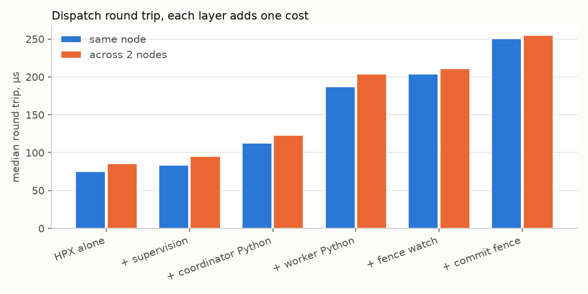
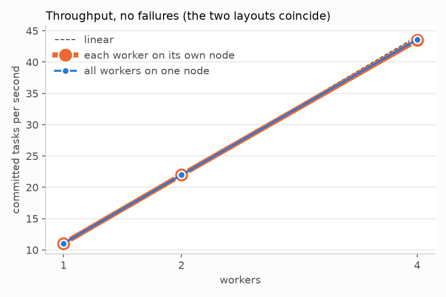
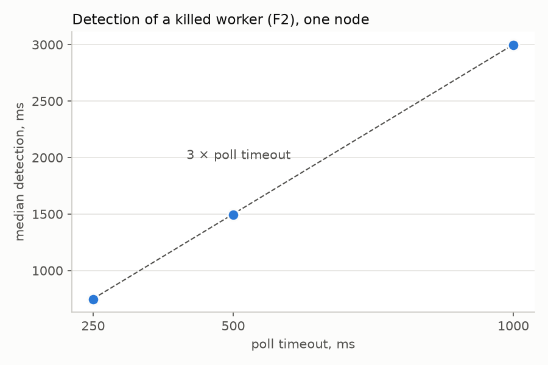
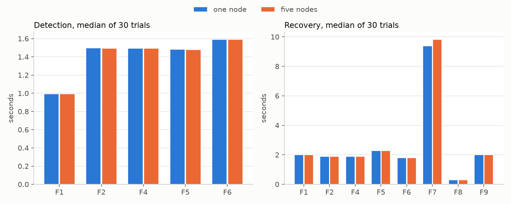

# Phase 5 measurement across nodes on HPX master (cc2be553)

Codes used in this document (full list: [plan, codes](../plan.md#codes)):

| Code | Meaning |
| --- | --- |
| F1 | kill before the node starts: SIGKILL the target's worker right after the coordinator picked it |
| F2 | kill mid-node: SIGKILL the target's worker while the node runs |
| F3 | kill after a direct effect: SIGKILL the worker after it wrote a Tier B effect, before it replied |
| F4 | zombie: SIGSTOP the worker until it is detected as failed, then SIGCONT it |
| F5 | multi-kill: SIGKILL 2 of 4 workers in one superstep |
| F6 | kill and replace: SIGKILL a worker, root `force_disconnect`, a new worker joins and takes work |
| F7 | coordinator crash: SIGKILL the coordinator mid-run; a new one resumes from the checkpoint |
| F8 | slow, not dead: SIGSTOP a worker for less than the detection time, then SIGCONT |
| F9 | abandoned dispatch: dispatch timeout shorter than the node; the original result arrives late |
| G1 | gate, correct result: the final state hash equals the stock LangGraph baseline |
| G2 | gate, outbox exactly once: Tier A keys equal the baseline's and no key is applied twice |
| G3 | gate, no stale commit: no result accepted from a worker after the coordinator saw it fenced |
| G4a | gate, run completes within a bound (120 s per run) |
| G5 | gate, detection from HPX only: every fence comes from HPX, never from the harness |
| H5 | hypothesis: failure-free dispatch overhead is small relative to node latency |
| H6 | hypothesis: throughput scales with worker count for I/O-bound parallel branches |
| Tier A | outbox effect: the node returns an intent, the coordinator applies it after the commit fence, keyed; exactly once |
| Tier B | direct effect: the node performs it on the worker; at least once, effectively once only with a `keyed` sink |

**Date:** 2026-11-21. **Cluster:** Rostam, partition `medusa`, 1 to 5 nodes per job. **HPX:** master
`cc2be553fac9b1f2a372f4277d7c708e70bf7eb4`. **Plan:** [`docs/plan.md`](../plan.md) sections 14,
15 and 16, phase 5.

Code: [`python/src/langx/island.py`](../../python/src/langx/island.py) and
[`signal_agent.py`](../../python/src/langx/signal_agent.py) (islands across nodes),
[`bench/overhead_nodes.sbatch`](../../bench/overhead_nodes.sbatch),
[`experiments/01_durable_langgraph/`](../../experiments/01_durable_langgraph/) (`scaling.sbatch`,
`analyze_scaling.py`, `exp01.sbatch`, `collect_phase5.py`). Curated numbers:
[`results/phase5.json`](../../experiments/01_durable_langgraph/results/phase5.json). Earlier results:
[`phase4.md`](phase4.md), [`overhead.md`](overhead.md).

## Summary

* **H5 holds.** A full langX dispatch takes 254.9 µs with the worker on another node, 4.7 µs more
  than on one node; the HPX part takes 11.7 µs more. The overhead over an in-process call is about
  0.24% of a 100 ms node, against the plan's 10% bound.
* **H6 holds.** Throughput is 11.0, 22.0 and 43.5 tasks per second with 1, 2 and 4 workers, a
  scaling efficiency of 0.996 and 0.986; all 180 runs equal the baseline. Workers on their own
  nodes and workers on one node give the same numbers.
* **The failure matrix passes across five nodes.** F1, F2 and F4 to F9 pass G1 to G5 in 30/30
  trials each, workers on four nodes and the root and coordinator on a fifth. Detection and
  recovery are within a few ms of the one-node results, except F7 recovery, 0.4 s longer.
* **Detection is three poll windows.** At a poll timeout of 250, 500 and 1000 ms a killed worker
  (F2) is seen fenced after 746, 1496 and 2997 ms, a spread of a few ms; F8 with a freeze of half
  a poll window gave no eviction at any setting.
* **Across nodes F7 can re-run a committed task.** In a few trials (median 0, at most 2 tasks) the
  resumed run executed a task the old coordinator had already committed; the outbox key kept its
  effect at one application. On one node this did not happen in 30 trials.
* **The baseline is about 25 times faster than one worker.** The in-process baseline runs the 32
  searches of a loop in parallel threads (270 tasks per second); a langX worker runs one node at
  a time, so it tops out near 1 / node latency.

## Setup

| Item | Value |
|---|---|
| Nodes | medusa02 to medusa08, 24 cores each; one node per role as listed per job |
| Placement | root and coordinator on the first node; workers on the others, in turn |
| Transport | TCP parcelport over the cluster network |
| Launch | workers through `srun` steps inside the allocation, one helper per worker node |
| Clock | every timestamp on the coordinator's node; a signal sent through a node's helper is timed as the midpoint of the request, off by at most half its round trip (0.2 to 0.3 ms here) |
| Python stack | Python 3.12.3, LangGraph 1.2.16, langgraph-checkpoint-sqlite 3.1.2 |

| Job | Nodes | Purpose |
|---|---|---|
| 224570 | 2 | dispatch overhead, same node and across two, Python layers and HPX floor, 3 reps |
| 224571 | 5 | throughput with 1, 2, 4 workers, both layouts, 30 runs each |
| 224572 | 5 | first failure smoke run; cancelled, every remote start took about 30 s (below) |
| 224573, 224574 | 1 | F2 and F8 at poll timeout 250 and 1000 ms, 30 trials each |
| 224575 | 5 | failure smoke run, 2 trials each, after the fix |
| 224576 | 5 | failure matrix, 30 trials each; one F7 trial lost to a port clash (below) |
| 224611 | 5 | F7 again after the fix, 30 trials |

F3 is left out across nodes: its Tier B sink is one SQLite file written by several workers, which
would sit on the shared file system, where SQLite locking is not reliable. F3 is covered on one
node in phase 4.

## Dispatch overhead across nodes (job 224570)

Median p50 of 3 reps × 2000 sequential calls, 100-byte payload, in µs.

| Layer | Same node | Across 2 nodes | Difference |
|---|---|---|---|
| HPX alone (`hpx::async`, C++ to C++) | 74.9 | 85.3 | +10.4 |
| + supervision (`dispatch_work`) | 83.3 | 95.0 | +11.7 |
| + coordinator Python (GIL, completion pipe, asyncio) | 112.5 | 122.7 | +10.2 |
| + worker Python (hand-off to its thread, JSON) | 187.2 | 204.1 | +16.9 |
| + fence watch | 204.1 | 210.9 | +6.8 |
| + commit fence (`Coordinator.execute`) | 250.2 | 254.9 | +4.7 |
| in-process node handler and decode, no HPX | 10.4 | 10.4 | |

The network adds about 10 to 17 µs to each layer below the commit fence, but less to the full
dispatch. One reading is that on one node the coordinator and worker compete for the same cores,
which offsets part of the network cost; this was not measured. p99 is higher across nodes (for
example 355 µs against 235 µs for the worker Python layer).

Overhead ratio (plan 14.2): (254.9 − 10.4) µs over a 100 ms node is 0.24%.

## Throughput and scaling (job 224571)

`research_agent` with no failures, width 32, 2 loops, 100 ms search latency, 71 tasks per run, 30
runs per point.

| Workers | Layout | Runs equal baseline | Tasks per second, median [min, max] | Efficiency |
|---|---|---|---|---|
| 1 | own nodes | 30/30 | 11.03 [10.92, 11.04] | 1.0 |
| 2 | own nodes | 30/30 | 21.97 [21.52, 21.98] | 0.996 |
| 4 | own nodes | 30/30 | 43.50 [41.99, 43.56] | 0.986 |
| 1 | one node | 30/30 | 11.04 [10.94, 11.04] | 1.0 |
| 2 | one node | 30/30 | 21.97 [21.53, 21.98] | 0.995 |
| 4 | one node | 30/30 | 43.59 [41.74, 43.61] | 0.987 |

The in-process baseline ran 263 to 274 tasks per second. The searches only wait, so neither the
network nor shared cores change the result; each worker runs one node at a time (plan 8.3), which
caps a worker near 10 tasks per second at 100 ms per search.

## Poll timeout (jobs 224573, 224574; 500 ms from phase 4, job 223238)

One node, 30 trials per point. Median [min, max] in ms.

| Poll timeout | F2 detection | F2 recovery | F8 evictions | Gates |
|---|---|---|---|---|
| 250 ms | 746.1 [744.7, 747.4] | 1802.6 [1801.9, 3003.6] | 0/30 | all 30/30 |
| 500 ms | 1495.9 [1486.6, 1497.7] | 1901.6 [1896.2, 3106.0] | 0/30 | all 30/30 |
| 1000 ms | 2996.8 [2993.0, 2998.9] | 3403.8 [3395.9, 4602.1] | 0/30 | all 30/30 |

F8 freezes the worker for half the poll timeout at each setting (125, 250 and 500 ms).

## Failure matrix across five nodes (jobs 224576, 224611)

30 trials each. Median, p95, [min, max] in ms; one node from phase 4 (job 223238) for comparison.

| ID | Gates G1 to G5 | Detection, five nodes | Detection, one node | Recovery, five nodes | Recovery, one node |
|---|---|---|---|---|---|
| F1 | 30/30 | 992.0, 993.9 [989.7, 1683.4] | 993.5 | 2004.2, 2004.9 [2003.7, 2085.1] | 2003.5 |
| F2 | 30/30 | 1493.6, 1495.4 [1491.5, 1495.5] | 1495.9 | 1900.5, 1904.8 [1894.1, 3096.7] | 1901.6 |
| F4 | 30/30 | 1493.5, 1496.4 [1490.4, 1496.7] | 1495.2 | 1898.3, 3097.6 [1894.0, 3097.9] | 1903.7 |
| F5 | 30/30 | 1477.9, 1484.7 [1472.5, 1486.1] | 1483.8 | 2283.7, 2297.1 [2276.4, 2681.5] | 2291.4 |
| F6 | 30/30 | 1590.3, 1591.5 [1587.2, 1591.5] | 1591.9 | 1796.6, 2389.9 [1790.3, 2391.0] | 1798.4 |
| F7 | 30/30 (job 224611) | n/a | n/a | 9828.3, 10451.5 [9735.1, 11008.7] | 9390.6 |
| F8 | 30/30, 0 evictions | n/a | n/a | 301.7, 305.5 [300.4, 1502.9] | 301.8 |
| F9 | 30/30 | n/a | n/a | 2004.2, 2004.7 [2003.3, 2004.8] | 2003.4 |

The rest matches phase 4: F4 dropped 120 late replies and F9 30, none committed; no healthy worker
was fenced in any trial; the F6 replacement committed 21 tasks per trial; F1's coordinator
`hpx::stop()` hung in 30/30, as on one node.

* **F7 re-ran committed tasks in a few trials** (median 0, p95 1, max 2 per trial; 0 in 30 on one
  node). The coordinator commits a task, applying its outbox effect, before LangGraph saves that
  task's write to the checkpoint; a kill in between leaves the task to run again after resume.
  Its outbox key was already applied, so G2 held in 30/30. This is the case plan 9.3 relies on
  the outbox for. Why it shows up across nodes and not on one is not established.
* **F7 recovery is 0.4 s longer** across nodes; the fresh workers start on other nodes.
* **Outliers:** one F1 trial took 1683 ms to detect, about one poll window more than the rest;
  one F8 trial committed its target 1.5 s after the freeze, with no eviction and no retry.
  Neither was investigated.

## Harness problems found on the way

| Job | Problem | Fix |
|---|---|---|
| 224572 | every process started on another node took about 30 s to be seen: its ready file appeared on the coordinator's node only after the shared file system's cache expired, and a stop file reached the other node as late | helpers report their port over TCP, ready and exit files on another node are read by that node's helper, remote workers are stopped with SIGTERM |
| 224576 | one F7 trial crashed: a fresh worker's port, picked as free on the coordinator's node, was in use on its own node (`bind: Address already in use`) | the helper on the worker's node picks the port; F7 re-run as job 224611, 30/30 |

## Not established

* a re-run from a fresh checkout (plan phase 5 exit), not done yet;
* cross-node results for F3, left out for the SQLite reason above;
* why F7 re-runs committed tasks across nodes and not on one;
* scaling past 4 workers, CPU-bound nodes, and workers that run several nodes at once;
* poll timeouts other than 250, 500 and 1000 ms across nodes;
* whether HPX PR [#7865](https://github.com/TheHPXProject/hpx/pull/7865) removes the F1 coordinator stop hang.

## Claims and non-claims

Supported:

> On HPX master `cc2be553`, on Rostam, langX dispatch costs about 255 µs with the worker on another
> node, 5 µs more than on one node; throughput grows linearly from 1 to 4 workers for waiting
> nodes; and with workers on four nodes the failure matrix F1, F2 and F4 to F9 keeps the stock
> LangGraph final state in 30/30 trials each, with no outbox effect applied twice and no stale
> commit. Detection takes three poll windows at 250, 500 and 1000 ms.

Not claimed:

* no claim for CPU-bound nodes or more than 4 workers;
* no throughput claim against stock LangGraph, which runs branches in parallel threads in one
  process;
* no claim beyond Rostam's network and nodes.

## Next step

Re-run a subset from a fresh checkout, then phase 6: the short report and the upstream HPX issues.
